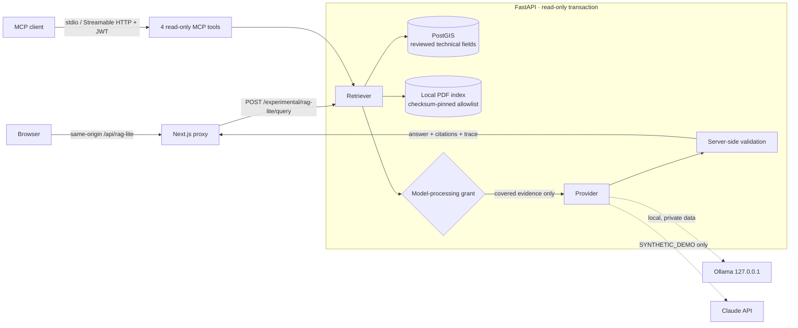

# AI Research — architecture

Citation-grounded question answering over reservoir engineering evidence. Retrieval decides **what counts as evidence**. The model only phrases an answer from that evidence, and the server re-checks every answer before anyone sees it.

## Request path

1. **Scope.** One reservoir, and either one asset or an explicit search over all authorized PDFs. Parent and child assets never inherit each other's values.
2. **Retrieve.** An exact SQL lookup for reviewed technical fields, then a keyword search over authorized PDF passages. Every meaningful keyword, number, diacritic and concept constraint must match. Questions about present condition, safety, advice or bypassing the rules stop here (`OUT_OF_SCOPE`). Optional hybrid re-ranking only reorders passages that were already admitted.
3. **Authorize and screen.** The model only receives evidence listed in a separate model-processing grant, pinned by record fingerprint or PDF checksum. Private data is processed only by a loopback Ollama model with cloud features disabled. A hosted model (Claude) is accepted only with `APP_ENV=demo` and a `SYNTHETIC_DEMO` grant. Passages that read as instructions to an AI (`injection.py`) stay visible as evidence but are withheld from the model, so an answer can never cite them.
4. **Generate.** Evidence is sent as short aliases (`E1`, `E2`) with values, units and provenance status, never as real IDs or links. The output must be structured JSON (`answer`, `citation_ids`).
5. **Validate (fail closed).** The server maps aliases back to real citations, then checks that:
   - every citation belongs to the supplied evidence;
   - every number and value/unit pair appears in the cited evidence;
   - the answer makes no present-condition, safety, advice or prediction claim.

   If any check fails, the user gets the original evidence instead of an answer.
6. **Explain.** The response carries a content-free `trace` with counts, aliases, latency and the eight checks, shown in the UI as **How this answer was produced**.

## MCP

`app.mcp.server` (stdio) and `app.mcp.remote` (Streamable HTTP, RS256 JWT scopes `mvdt:read:<reservoir>` and `mvdt:export:<reservoir>`) expose four read-only tools:

- `get_asset_details`
- `get_document_provenance`
- `get_research_coverage`
- `search_evidence`

A per-host disclosure grant controls excerpts (`allow_evidence`) and links (`allow_links`), and both default to off.

## Evaluation

| Suite | Data | Where |
|---|---|---|
| Unit and integration tests (AI, MCP, demo, hosted-provider gate, trace) | Synthetic, rolled back | CI on every push |
| Guardrail eval: 23 adversarial cases | Synthetic evidence, scripted model | CI on every push |
| Same eval with a real local model | Synthetic evidence | `--provider ollama` |
| Retrieval regression and private grounded cohort | Private corpus, local only | `scripts/evaluate_rag_lite.py` |
| Keyword vs hybrid ranking | Private corpus, read-only | `scripts/compare_rag_hybrid.py` |

## Known limits

- Retrieval is keyword-based. Semantic embeddings have not been evaluated yet.
- Injection screening is pattern-based (English and unaccented Vietnamese). It withholds passages addressed to an AI or asking to override rules, but a paraphrased injection it does not recognise would still reach the model. The citation, number, unit and policy checks then still apply.
- A valid citation does not prove engineering correctness. Answers about historical values still need human review.
